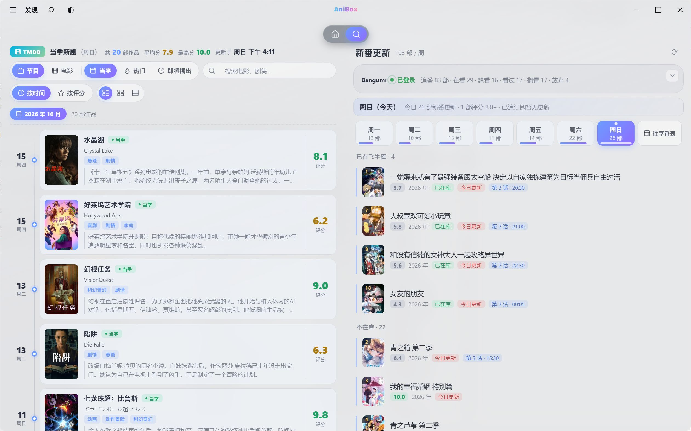
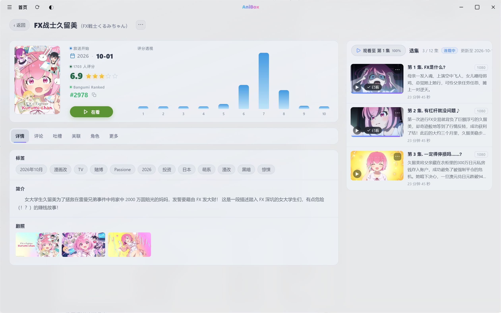
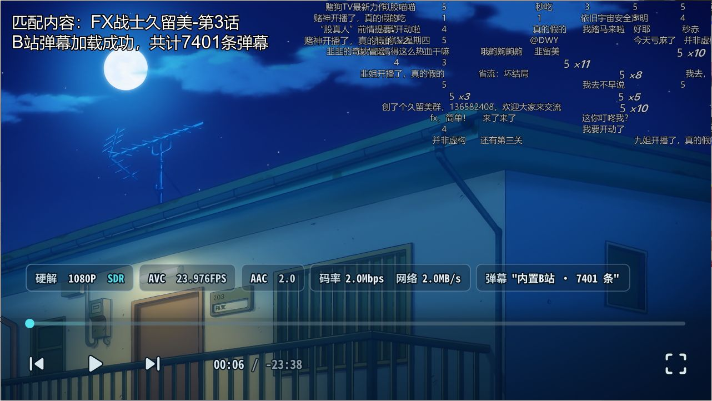
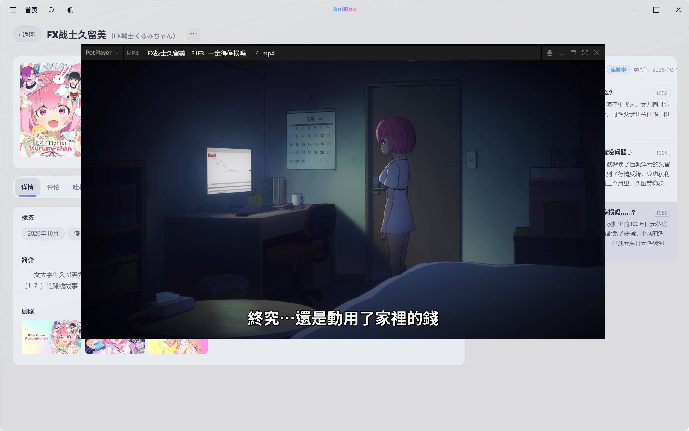
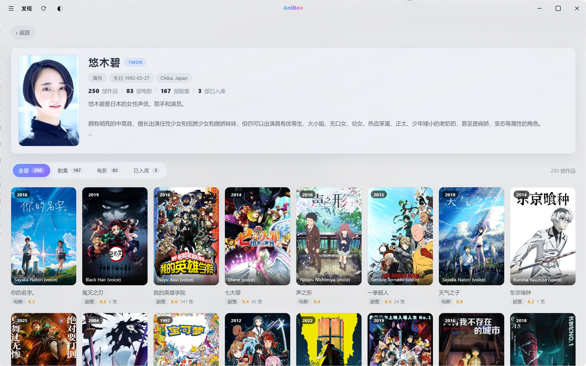

# AniBox · 飞牛影视第三方桌面客户端

<div align="center">

[](https://github.com/FNOSP/AniBox/releases)
[](https://tauri.app/)
[](https://react.dev/)
[](https://www.rust-lang.org/)
[](https://www.fnnas.com/)
[](fpk/README.md)
[](https://github.com/FNOSP/AniBox/releases)
[](https://github.com/FNOSP/AniBox/releases)
[](LICENSE)
[](https://github.com/FNOSP/AniBox/stargazers)
[](https://github.com/FNOSP/AniBox/forks)
[](https://github.com/FNOSP/AniBox/issues)
[](https://github.com/FNOSP/AniBox/commits)
[](https://github.com/FNOSP/AniBox/commits)
[](https://gitee.com/YDMY007/fntv-plus)

<a href="https://star-history.com/#FNOSP/AniBox&Date">
  <picture>
    <source media="(prefers-color-scheme: dark)" srcset="https://api.star-history.com/svg?repos=FNOSP/AniBox&type=Date&color=%236c9bff" />
    
  </picture>
</a>

</div>

> ###  重要警告与声明
>
> ** 本项目是个人开源作品，不代表任何官方立场，与飞牛影视官方无任何关联、合作或背书关系。**
>
> 使用前请务必知悉以下风险：
> - **非官方第三方客户端**：AniBox 为**飞牛影视（fnOS / 飞牛私有云）**的媒体库与播放场景定制，**非飞牛官方出品**；可能因飞牛端接口调整而失效、闪退或行为异常，**不保证长期稳定可用**。
> - **账号与隐私风险**：需登录你自己的飞牛影视 / NAS 账号，登录态与本机配置保存在本地；请仅在可信设备与网络环境使用，后果自负。
> - **本地播放与代理**：播放依赖你自己提供的 `mpv.exe` 或本机 PotPlayer，并通过本地 Go 代理中转 NAS 流媒体；请确保所播放内容符合所在地法律法规与版权规定。
> - **更新来源安全**：自动更新与热补丁仅从本项目官方渠道获取；请勿安装来源不明的补丁包，避免运行被篡改的代码。
> - **按「原样」提供、无担保**：基于 GPL-3.0 开源，**不提供任何明示或暗示担保**；因使用本项目产生的任何后果由使用者自行承担。

> **把飞牛影视，变成你桌面上的私人影院。** AniBox 是一个**为飞牛影视（fnOS / 飞牛私有云）定制的第三方 Windows 桌面客户端**：它不把网页塞进浏览器，而是用 **React 自绘界面**直接调用飞牛影视 API，以**独立 `mpv.exe` 进程**承担播放；再用 Bangumi / TMDB / AniList 元数据聚合、本地弹幕 shim、原生全局手柄、磁盘缓存与双通道更新，把「看片」这件事做成一套完整、可长期维护的桌面体验。

>  **项目地址 / 官网：https://690075.xyz** —— 下载与更新以本仓库 Releases 为唯一官方渠道。

>  **网页版入口 —— [AniBox fpk · 飞牛影视网页端增强](fpk/README.md)**：在 fnOS 应用中心装一次 fpk，电视 / 平板 / 手机 / 电脑打开浏览器就是增强版影视网页，影视应用零改动、卸载即还原。实机截图、功能清单与安装步骤见 **[fpk/README.md](fpk/README.md)**。

##  界面截图

<div align="center">
  
  <p><em>图：首页全屏 Hero 轮播（顶栏已含全局聚合搜索入口）</em></p>
</div>

<div align="center">

  <p><em>图：发现页 TMDB / Bangumi 双面板</em></p>
</div>

<div align="center">

  <p><em>图：两栏沉浸式详情页与标签页（含多版本切换、选集自动定位）</em></p>
</div>

<div align="center">

  <p><em>图：观影记录与年度报告</em></p>
</div>

<div align="center">

  <p><em>图：mpv 三源弹幕丰富影视体验</em></p>
</div>

<div align="center">

  <p><em>图：兼容本机自带 PotPlayer 调用</em></p>
</div>

<div align="center">

  <p><em>图：演员信息入库检测</em></p>
</div>

> 截图均为 AniBox 桌面端实机画面。全局搜索、手动元数据、多版本等新增功能的截图尚未补充，后续会随版本更新。

---

##  项目缘起与独立声明

> **AniBox 是一个独立开发的第三方桌面客户端，产品名统一为 AniBox。**

### 项目沿革（原 Fntv-Plus → AniBox）

> - **改名**：AniBox 由原 **Fntv-Plus** 项目**改名而来**。
> - **全面重写**：改名后当前版本已**全面重写 / 重构**（**Tauri 2 + Rust + React + TypeScript + Vite**），与早期 Electron 版本在**架构与代码上相互独立**，并非旧版的延续。
> - **旧版定位**：旧 Electron 版仅作历史参考，**不代表当前实现**；请勿以旧版代码、界面或行为推断本版本。

### 独立声明

> - **仓库目录名**：本仓库目录为 `AniBox`，**软件产品名统一为 AniBox**；本文档中的「AniBox」均指本仓库构建的桌面客户端。
> - **技术路线**：区别于「网页注入」式方案，AniBox 采用 **Tauri 2 + Rust + React + TypeScript** 自绘界面，直连飞牛影视 API，并以独立 mpv 进程播放。
> - **独立发展**：本项目独立维护、独立发布，不代表任何上游或官方立场。
> - **许可证**：本项目采用 **GPL-3.0**，完整条款见 [LICENSE](LICENSE)。

> ** 免责声明**：本项目为第三方客户端，与飞牛影视官方无关。本项目仅为个人学习、交流等非商业用途的开源项目，不代表任何官方立场。使用前请确保遵守相关服务条款与版权规定，因使用本项目产生的任何后果由使用者自行承担。

---

##  主要功能

> 每个功能点下面补充了具体场景说明，方便上手。

### 登录与连接

- ** NAS 登录与宽容地址输入** — NAS 地址 + 用户名 + 密码登录，地址支持裸 IP、无协议头、全角冒号等宽容写法：
  -  记不清完整 URL 也没关系，直接填 `192.168.1.10:18888` 这类裸地址即可，客户端会自动补全协议与端口。
- ** 登录态与自动登录** — 登录态（token）与可选「记住密码 / 自动登录」保存在本机配置中：
  -  勾选自动登录后，下次启动会静默重登，省去每次输入。
- ** 首次启动免责声明** — 首次启动展示免责声明，同意后方可使用；设置 → 关于可再次查看：
  -  想重新阅读条款，随时在「设置 → 关于 → 免责声明」里查看。
- ** 数据目录迁移** — 旧 identifier `com.fntv.plus.tauri2` 的配置、缓存与 WebView 数据会自动迁移到 `com.anibox.app`：
  -  从早期版本升级时无需手动搬配置，首次启动自动完成迁移。

### 首页与界面

- ** 全屏 Hero 轮播** — 无限循环轮播，首尾克隆位无缝衔接；支持影片透明 Logo 或文字标题：
  -  打开客户端即是沉浸式海报墙，鼠标悬停暂停、可手动切换。
- ** 「继续观看」横排** — 首页首屏展示未看完内容，一键续播：
  -  追到一半的片子直接从这里接着看，不用再翻媒体库。
- ** 按媒体库横排与展示管理** — 首页按媒体库分组横排，可隐藏指定库：
  -  库太多显得杂乱时，在设置里隐藏不常看的库，首页更清爽。
- ** 顶栏全局聚合搜索** — 顶栏搜索入口（`Ctrl K` / `⌘ K`）一次检索媒体库全部内容，结果按「全部 / 电影 / 电视剧 / 电视直播 / 人物 / 其他」分页：
  - 支持键盘上下选择、左右切页、回车直达详情；人物结果进入演员页，可直接续播的条目一键跳转。
  -  片名只记得一半时，不用先想它在哪个库，直接 `Ctrl K` 搜。
- ** 侧栏导航** — 首页、收藏、全部 / 电影 / 电视节目 / 电视直播 / 其他分类；底部为用户信息与快捷操作卡：
  -  分类切换集中在左侧栏，路径统一。
- ** 媒体库卡片信息增强** — 首页媒体库横排的海报卡补充年份 / 季集数 / 更新时间 / 续看剩余等信息，缺失字段自动隐藏：
  -  不点进详情也能判断「这是第几季、更新到哪、还剩多少没看」。
- ** 外观与性能模式** — 浅色 / 深色主题、界面透明度滑杆（默认 85%）、性能模式（关闭动画与磨砂）：
  -  性能模式下透明度不再被磨砂层「吃掉」，外壳底色跟随设置正确生效；低配机可关闭动效换流畅度。

### 发现与元数据

- ** TMDB 面板** — 热门 / 发现 / 搜索，条目可直接进入详情：
  -  想找片时先用 TMDB 面板浏览热门或搜索，点条目直达详情页。
- ** Bangumi 面板** — 每日放送日历、当季番表、往季番表查询、番组详情、评论 / 吐槽 / 关联 / 角色：
  -  追番党看当季 / 往季番表，按天查看放送日历。
- ** AniList 放送时刻** — 按天获取番剧的精确放送时刻（Bangumi 仅提供星期与首播日）：
  -  详情页的放送时间更精确，方便卡点追更。
- ** Bangumi 账号绑定** — 手动粘贴 Access Token 绑定，支持追番收藏状态同步与冲突策略：
  -  绑定后追番状态可在客户端与 Bangumi 之间同步。
- ** 手动获取元数据（本地覆盖）** — 海报卡「⋯ → 刷新元数据」打开手动匹配弹窗，同时搜索 **TMDB** 与 **Bangumi 镜像**，两路结果分区展示、单选确认：
  - 选定后**只写本地**（`metadata_overrides.json`），**不调用飞牛任何写接口**；按「剧 guid」统一覆盖该剧在首页 / 媒体库 / 详情页 / 轮播中的标题、简介、评分、海报、季集数等字段。
  - 可随时「清除覆盖」恢复飞牛原始数据；原始响应不会被修改。
  -  飞牛自动刮削匹配错片时，手动选一次正确的 TMDB / Bangumi 条目即可，不必改 NAS 上的文件。

### 媒体库与收藏

- ** 媒体库网格与分类** — 网格浏览、分类筛选、文件夹层级、虚拟「收藏」入口：
  -  大库也能按分类与文件夹层层下钻，快速定位。
- ** 海报卡「已看」切换** — 写回飞牛，接口不可用时降级为本地标记：
  -  看完随手标「已看」，飞牛接口异常时也不会丢标记。
- ** 本地收藏** — 飞牛收藏接口不可用时由客户端落盘，列表与飞牛收藏合并展示：
  -  收藏入口始终可用，本地与远端收藏一起看。

### 详情页

- ** 两栏沉浸式详情** — 左侧选集、右侧详情，全屏背景海报：
  -  点进作品即进入沉浸式布局，选集与信息一屏可见。
- ** 选集自动定位** — 打开剧集详情时，右栏选集自动滚动到「上次观看的那一集」，跨季会先切季再定位：
  - 每个条目只自动定位一次；用户手动滚动或点选后立即放弃定位，不会把正在翻选的你拉回去。
  -  几十集的年番不用再一集集往下翻。
- ** 多版本切换** — 同一电影 / 剧集存在多个文件（多版本）时显示版本选择器：
  - 默认选中「上次播放的版本」（服务端记忆）→ 本机记忆 → 第一个版本；电影详情页与剧集选集共用同一套版本盒子，仅版本数 > 1 时显示。
  -  同一部片同时有 1080p / 4K / 导演剪辑版时，起播前先挑清楚。
- ** 标签页** — 详情 / 评论 / 吐槽 / 关联 / 角色 / 更多（无 Bangumi 条目 id 时隐藏评论与吐槽）：
  -  想快速看评论、关联作品或角色，切换标签即可。
- ** 剧照灯箱与预告** — 演职人员、角色、关联条目、TMDB 剧照与预告、剧照灯箱：
  -  点开剧照可放大浏览，预告片可直接播放。
- ** 评分与元数据编辑** — 我的评分 / 评语、Bangumi 评分组件、简介展开、元数据编辑：
  -  打分、写短评、补全简介都在详情页完成。

### 观影记录

- ** 合并去重** — 数据 = 飞牛 `play/list` ∪ 本机播放历史，Rust 侧合并去重并按「作品」聚合：
  -  无论在哪端看过，记录都会汇总到同一条作品下。
- ** 活跃度热力图** — 已看完 / 在观看双栏海报墙，按年 / 季 / 月 / 周切换：
  -  回看自己的观影密度与习惯，一目了然。
- ** 年度观影报告** — 总时长、部数、月度节奏、观影时刻、年度 TOP5、连续天数、看完率，可导出 PNG 长图：
  -  年底翻一翻自己的观影画像，喜欢就导出分享。

### 播放与弹幕

- ** mpv（默认）** — 独立进程 + 命名管道 IPC，uosc 底栏、右键菜单、字幕、着色器原生可用：
  -  独立进程不进程内嵌，播放器自身的交互与脚本能力完整保留。
- ** PotPlayer（可选）** — 命令行起播 + `potctl.exe` 轮询进度；Referer/UA 由本地 relay 代转：
  -  习惯 PotPlayer 快捷键 / 滤镜的用户可切换为外部播放器。
- ** 弹幕** — 本地 `127.0.0.1:22347` shim 为 uosc_danmaku 提供 B 站弹幕接口；可选自建 `danmu_api` 作为优选源（最多 4 个地址故障转移），未命中自动降级内置 B 站：
  -  弹幕随视频自动加载；自建源不可用时自动降级，不中断观看。
- ** 片头片尾跳过** — mpv 内 `smart_skip` 脚本 + **TheIntroDB v4** 自动识别片头 / 片尾并跳过；也支持手动标记：
  - Rust 侧按「guid → TMDB ID / 季 / 集」下发 `skip-metadata`，无 TMDB 锚点时不误触发；识别不到时保持正常播放。
  -  追番连播时不必每次手动拖过 OP / ED。
- ** 电视直播直链** — 直播条目直接取 `play/info.live_channels[]` 的可播地址起播（不走 Go 代理的 `playvideo`，该接口对直播返回 500）：
  - 自动挑选可用线路并记录线路名；直播无剧集概念，不写弹幕匹配元数据，避免空搜。
  -  侧栏「电视直播」里的频道现在可以直接点了。
- ** 播放历史** — 起播即记录到本机 `history.json`，与飞牛记录合并展示：
  -  本机记录作为飞牛记录的补充，跨端也能对上。

### 手柄与系统

- ** 原生全局手柄** — gilrs / XInput 原生监听，mpv 或 PotPlayer 在前台时同样可用：
  - **标准映射**：方向键焦点导航、A 确认 / 暂停、B 返回 / 停止、LB/RB 切页或 ±5s、LT/RT 调倍速、X 收藏、Start 打开设置。
  - **可调参数**：摇杆死区、方向阈值、长按首次延迟、连跳间隔。
  -  接上手柄即可在沙发上操作；窗口失焦时 WebView 会暂停手柄输入，点回窗口恢复。

### 更新与维护

- ** 热补丁** — 只覆盖前端静态资源：下载 → sha256 校验 → 原子切换 → 可回滚：
  -  小修复无需重装，下载补丁后重载即生效；失败可一键回滚。
- ** 全量更新** — 后台下载安装包（Range 续传），完成后拉起 NSIS 安装器，不跳转 GitHub：
  -  大版本更新在应用内完成下载与安装。
- ** 设置内更新面板** — 检查更新、更新说明、下载进度、补丁应用 / 回滚：
  -  所有更新操作集中在设置面板，状态一目了然。

### 反馈与诊断

- ** 应用内工单** — 新建反馈、我的工单、会话回复、20 秒轮询状态：
  -  遇到问题直接在客户端提交工单，无需另开网页。
- ** 日志与诊断** — 诊断日志、mpv 日志、调试日志开关、组件级过滤、诊断信息导出：
  -  反馈内容与日志在提交前做脱敏处理。

### 网页端增强（fpk · 可选）

- ** AniBox fpk 微应用** — 仓库内 `fpk/` 为飞牛影视（fnOS）的网页端增强微应用：在 NAS 应用中心装一次 fpk，电视 / 平板 / 手机 / 电脑打开浏览器就是增强版影视网页，零安装、影视应用文件零改动、卸载即还原：
  - 已随主仓库统一改名为 **AniBox**，安装包产物为 `AniBox-<版号>.fpk`（ARM64 为 `AniBox-<版号>-arm64.fpk`），与桌面端随同一 Release 发布。
  - 元数据 / 图片经内置镜像取数（缺密钥时自动降级官方域），并内置弹幕源、界面美化、片头片尾跳过与跨设备播放记忆。
  - 桌面端与网页端共用同一套前端增强逻辑：桌面版先行开发，确认后移植到 `fpk/src/preload`。
  - **点这里切换到 → [`fpk/README.md`](fpk/README.md)**：实机截图（存于本仓库 `docs/pic/`）、完整功能清单、安装步骤与 Web 版 vs 桌面版对照表都在那边。

### 在线资源（第三方规则源）

- ** 规则源检索与播放** — 无飞牛选集数据的条目，右栏自动换成「在线资源」面板：按标题多源并行搜索 → 按源分组（可直接播放 / 需要验证 / 无结果 / 检索失败）→ 线路与选集 → 解析直链 → 独立 mpv 播放：
  - 规则采用社区 [Predidit/KazumiRules](https://github.com/Predidit/KazumiRules) 目录格式，面板内可检查更新、逐条安装 / 全部更新；直链解析带嗅探进度提示，反爬验证支持图片验证码与「打开网页手动验证」兜底。
  -  内容**全部由用户自行安装的第三方规则（站点）提供**：本软件不内置、不运营任何内容站点，也不提供、不存储、不分发任何影视内容；请遵守当地法律，详见下方「版权与合规」。

---

##  技术栈与架构

### 总览

| 层 | 技术 / 实现 |
| --- | --- |
| 桌面壳 | **Tauri 2**（Rust 2024 edition） |
| 前端 | **React 19 + TypeScript + Vite**，Lucide 图标 |
| 样式 | 原生 CSS 分层（`src/styles/*.css`），浅色 / 深色主题 |
| 播放内核 | **独立 `mpv.exe` 进程** + `--input-ipc-server` 命名管道（JSON 行协议） |
| 播放器 UI | mpv 便携配置中的 **uosc** 与弹幕脚本 |
| 外部播放器 | 本机 **PotPlayer**（可选）+ 随包 `potctl.exe` 进度读取 |
| 本地代理 | **Go `proxy.exe`**（`127.0.0.1:22346`），负责 NAS 拉流中转 |
| 弹幕 shim | 系统 Node 运行 `danmaku-shim.cjs`（`127.0.0.1:22347`） |
| 图片协议 | 自定义 `fntvimg` 协议（NAS / TMDB / Bangumi 图片代理 + 缓存） |
| 热补丁协议 | 自定义 `fntvweb` 协议（前端资源覆盖层） |
| 元数据 | Bangumi 自建镜像、TMDB 自建镜像、AniList 官方 GraphQL |
| 手柄 | Rust **gilrs** 原生监听，事件推送到前端 |
| 缓存 | 内存 → 磁盘 → 网络三级缓存，磁盘 LRU 淘汰 |

> **mpv 说明**：本项目使用**第三方预编译的 mpv 版本**（**非本项目构建 / 编译**），具体来自 [Yaozhil/mpv-Yaozhi](https://github.com/Yaozhil/mpv-Yaozhi) 项目；版权归 **mpv 项目及其构建者**所有，遵循其 **GPL / LGPL** 许可；本项目**不声称拥有 mpv 代码**，也不随包分发 mpv 二进制。

### 运行时拓扑

```text
┌──────────────────────────────────────────────┐
│ WebView2                                     │
│ React 19 + TypeScript                        │
│ 首页 / 发现 / 媒体库 / 详情 / 观影记录 / ... │
└───────────────┬──────────────────────────────┘
                │ Tauri IPC（invoke / event）
┌───────────────▼──────────────────────────────┐
│ Rust 核心（Tauri 2）                          │
│ config · fnapi/authx · mpv · player · update │
│ bgm · tmdb · webrs · history · feedback ...  │
└───┬───────────┬───────────┬───────────┬──────┘
    │           │           │           │
 mpv.exe     proxy.exe    node shim   WebView 嗅探
 命名管道     :22346       :22347      :22348+
    │
 PotPlayer（可选）+ potctl.exe；需要请求头时走 relay :22349
```

### mpv 播放架构

- **独立进程，不进程内嵌**：`mpv.exe` 自带消息循环，鼠标 / 键盘 / uosc / 右键菜单 / 缩略图 / 弹幕 Lua 脚本全部原生可用。
- **控制与事件**：`--input-ipc-server=\\.\pipe\anibox-mpv-<pid>`，前端接收 `mpv-event { event: "property-change", id, data }`。
- **会话复用**：同一 mpv 进程内 `loadfile replace` 切换剧集，避免反复启动。
- **请求头**：播放请求可通过 `referrer` / `user-agent` / `http-header-fields` 传入；库内播放会清空残留头。
- **便携配置**：uosc、input.conf、脚本、着色器来自 `mpv.exe` 同目录的 `portable_config`，由用户自行提供（本仓库不分发 mpv 二进制）。
- **第三方预编译**：所用 `mpv.exe` 为**第三方预编译版本**（非本项目构建 / 编译），来自 [Yaozhil/mpv-Yaozhi](https://github.com/Yaozhil/mpv-Yaozhi) 项目（本地运行时目录 `third_party/fntv-mpv` 即基于该项目，该目录不入库、不随仓库分发），版权归 mpv 项目及构建者所有，遵循其 GPL/LGPL 许可。

### 自建镜像与降级

客户端默认优先访问自建镜像（可用环境变量覆盖）：

| 用途 | 默认端点（代码内） | 说明 |
| --- | --- | --- |
| Bangumi API / 图片 | `bgm.*****.xyz` | 带准入签名；缺密钥时降级直连官方域 |
| TMDB API / 图片 | `tmdb.*****.xyz` | 镜像注入服务端 key；缺密钥时降级用户自己的 key |
| GitHub 下载 | `gh.*****.xyz` | 更新包解析 `/app/resolve` |
| 匿名统计 / 反馈 | `stats.*****.xyz` | `/ping`、`/feedback` 等 |

- 镜像准入签名：`x-fntv-app` + `x-fntv-ts` + `x-fntv-sign`，密钥**只从运行时环境或编译期 `option_env!` 读取，绝不写入仓库**。
- 缺密钥 / 网络错误 / 超时 / 5xx / 429 会按模块既定策略降级；401 与其他 4xx 属确定性拒绝，不降级。
- AniList 官方 GraphQL 直连，按天缓存，遵守其非商业与限流条款。

### 磁盘缓存

- 位置：`<app_data_dir>/cache/`（`img/` 与 `json/` 两池）。
- 行为：内存命中 → 磁盘命中 → 网络；命中磁盘不回源。
- LRU：超过 `cache_limit_mb` 后按最后访问时间淘汰到上限的 90%，内存与磁盘同步清理。
- 设置面板可查看占用、修改上限（1/2/5/10 GB 或不限）、立即清理。

---

##  项目结构

```text
AniBox/                            # 仓库目录名（产品名 AniBox）
├── src/                           # 前端（React + TypeScript）
│   ├── App.tsx                    # 应用外壳：视图路由、登录态、主题、全局事件
│   ├── main.tsx                   # 入口：主题预置、挂载
│   ├── types.ts                   # 前后端共享类型
│   ├── icons.tsx                  # 图标封装（Lucide）
│   ├── components/
│   │   ├── home/                  # 首页：Hero 轮播、继续观看、媒体库横排
│   │   ├── discover/              # 发现：TMDB / Bangumi / 番表 / 账号
│   │   ├── library/               # 媒体库网格与分类
│   │   ├── detail/                # 详情页、标签页、评分、元数据编辑、剧照灯箱
│   │   ├── history/               # 观影记录与年度报告
│   │   ├── webrs/                 # 在线资源面板（规则源搜索 / 选集 / 嗅探播放）
│   │   ├── feedback/              # 反馈工单与日志诊断
│   │   ├── settings/              # 设置面板
│   │   ├── search/                # 顶栏全局聚合搜索（Ctrl K，分页 / 键盘导航）
│   │   ├── sidebar/ shell/        # 侧栏、标题栏、导航胶囊
│   │   ├── login/                 # 登录页
│   │   ├── disclaimer/            # 首次启动免责声明
│   │   └── common/                # 海报卡、滚动行、元数据手动匹配弹窗、头像兜底等
│   ├── hooks/                     # useGamepad、useLibIndex、useRefresh 等
│   ├── lib/                       # api、焦点导航、图片、自适应色调、格式化、主题等
│   ├── styles/                    # 分层 CSS（tokens、shell、各页面、45-search）
│   └── assets/                    # 内置字体与静态资源
├── src-tauri/                     # Rust 桌面端
│   ├── src/
│   │   ├── lib.rs                 # Tauri 命令注册与应用启动
│   │   ├── main.rs                # 二进制入口
│   │   ├── config.rs              # config.json 读写与迁移兼容
│   │   ├── fnapi.rs / authx.rs    # 飞牛 API 客户端与 Authx 签名
│   │   ├── mpv.rs                 # mpv 进程、命名管道 IPC、事件
│   │   ├── player.rs              # mpv / PotPlayer 统一启动 + 本地 relay
│   │   ├── proxy.rs               # Go 代理守护（22346）
│   │   ├── danmaku_shim.rs        # 弹幕 shim（22347）
│   │   ├── webrs.rs               # 在线资源规则模块（Kazumi 规则兼容）
│   │   ├── bgm.rs / bgm_account.rs# Bangumi 数据与账号同步
│   │   ├── tmdb.rs / anilist.rs   # TMDB 元数据 / AniList 放送时刻
│   │   ├── mirror_sign.rs         # 镜像准入签名（BGM / TMDB 共用）
│   │   ├── imgproto.rs            # fntvimg 图片协议
│   │   ├── disk_cache.rs          # 三级缓存与 LRU
│   │   ├── history.rs             # 本机播放历史、合并、年度报告数据
│   │   ├── watched.rs / favorites.rs
│   │   ├── metadata_override.rs   # 手动元数据本地覆盖（按剧 guid 叠加，不写飞牛）
│   │   ├── feedback.rs            # 反馈工单、日志与诊断
│   │   ├── usage_stats.rs         # 匿名统计
│   │   ├── update.rs              # 全量更新 + 热补丁 + fntvweb 协议
│   │   ├── migrate.rs             # 数据目录迁移
│   │   └── libmpv.rs              # 诊断日志与崩溃记录
│   ├── assets/                    # 弹幕 shim 的 Node 源码（include_str!）
│   ├── resources/potctl.exe       # PotPlayer 进度读取工具（随包）
│   ├── capabilities/              # Tauri 权限声明
│   ├── icons/                     # 应用图标
│   ├── Cargo.toml                 # Rust 依赖与 release 配置
│   └── tauri.conf.json            # 窗口、打包、资源与 identifier
├── public/                        # Vite 公共静态资源
├── fpk/                           # 飞牛影视网页端增强微应用（AniBox fpk，选择性入库）
├── dev.cmd                        # 开发启动脚本（清残留 → tauri dev）
├── index.html                     # 前端入口 HTML
├── package.json                   # 前端依赖与脚本
├── vite.config.ts                 # Vite 配置（端口 1420）
├── tsconfig*.json                 # TypeScript 配置
└── LICENSE                        # GNU GPL-3.0
```

> 说明：`mpv.exe`、`proxy.exe` 与 `portable_config` **不在本仓库内**（`third_party/` 按仓库规则不入库）。
> 发布构建前需在本地准备 `third_party/fntv-mpv/` 与 `third_party/proxy/proxy.exe`：
> `tauri.conf.json` 的 `beforeBuildCommand` 会调用 `tools/stage-bundle-resources.mjs`，
> 把它们裁剪（排除 Cookie、播放记录、缓存、日志与备份）后复制到
> `src-tauri/bundle-resources/`，再由 `bundle.resources` 打进安装包。
> 缺少 `third_party/` 时发布构建会明确报错；日常 `dev.cmd` 不受影响。
> 发布 / 运维脚本按仓库规则不入库（本地脚本）。

---

##  安装与下载

### 预编译版本（推荐）

前往本仓库 **Releases** 页面下载最新版本（具体文件名以 Release 页面为准）：

| 平台 | 文件类型 | 说明 |
|------|----------|------|
|  Windows | NSIS 安装包（`.exe`） | 支持自定义安装路径、创建桌面 / 开始菜单快捷方式。 |
|  fnOS（NAS） | fpk 应用包（`.fpk`） | 网页端：NAS 装一次，电视 / 平板 / 手机 / 电脑浏览器即用；x86_64 / ARM64 双架构，详见 [`fpk/README.md`](fpk/README.md)。 |
|  热补丁 | 补丁包（`-hotfix`） | 由应用内更新面板获取，重载即生效，无需下载全量包。 |

> 桌面端当前发布目标为 **Windows 10 / 11 x64**，其他桌面平台未验证；网页端 fpk 面向**飞牛 fnOS**（x86_64 / ARM64）。

### Windows 运行环境：WebView2 Runtime

AniBox（Tauri v2）在 Windows 上依赖 **Microsoft Edge WebView2 Runtime**（Evergreen）。
**运行时缺失时应用会直接退出或白屏**，连设置面板都打不开。

- **安装包已内置兜底**：`src-tauri/tauri.conf.json` 的
  `bundle.windows.webviewInstallMode` 设为 `downloadBootstrapper`（`silent: true`）。
  NSIS/MSI 安装时会自动检测并下载安装 WebView2（需要联网）。
  如需离线分发，可改为 `offlineInstaller`（安装包 +约 127 MB）或
  `embedBootstrapper`（+约 1.8 MB，仍需联网下载运行时）。
- **应用内入口**：设置 →「关于」→「WebView2 运行时」显示已安装版本；
  未安装或版本低于 109 时提供「下载安装」按钮（打开微软官方 Bootstrapper）。
- **应用完全无法启动时**：双击仓库根目录的 **`安装WebView2.cmd`**
  （或手动运行 `tools/ensure-webview2.ps1`）。脚本只做检测 + 下载/启动官方安装器，
  不随仓库分发任何二进制：

  ```powershell
  # 只检测（退出码 0=正常，1=缺失/过低）
  pwsh -NoProfile -File .\tools\ensure-webview2.ps1 -CheckOnly

  # 询问后下载并启动安装器
  pwsh -NoProfile -File .\tools\ensure-webview2.ps1

  # 静默安装（适合脚本/部署）
  pwsh -NoProfile -File .\tools\ensure-webview2.ps1 -Silent
  ```

- 官方下载地址：
  [Evergreen Bootstrapper](https://go.microsoft.com/fwlink/p/?LinkId=2124703)（约 1.8 MB）、
  [x64 离线安装包](https://go.microsoft.com/fwlink/?linkid=2124701)。
  微软未提供官方国内镜像；第三方镜像可能过期或被篡改，本项目不内置。

> 检测口径：注册表
> `HKLM\SOFTWARE\WOW6432Node\Microsoft\EdgeUpdate\Clients\{F1E7B9A0-…}\pv`
> （兼容 `HKLM\SOFTWARE\Microsoft\...`，按显示名含 `WebView2` 匹配，不硬编码完整 GUID），
> 以及 `%ProgramFiles(x86)%\Microsoft\EdgeWebView\Application\<版本>\msedgewebview2.exe`
> （兼容 `%ProgramFiles%` 与 `%LOCALAPPDATA%` 的按用户安装）。

### 本地构建

```bash
# 1. 克隆仓库
git clone <仓库地址>
cd AniBox

# 2. 安装前端依赖
npm install

# 3. 开发模式（Vite + Tauri，首次编译较慢）
npm run tauri dev
# 或使用仓库脚本（会先清理残留 anibox.exe / proxy.exe）
dev.cmd

# 4. 仅构建前端
npm run build

# 5. 构建安装包（NSIS）
npm run tauri build

# 6. Rust 单元测试
cargo test --manifest-path src-tauri/Cargo.toml
```

> **提示**：`tauri dev` 默认使用 `http://localhost:1420`。端口被占用时 Windows 可能返回 `EACCES` 而非 `EADDRINUSE`，`dev.cmd` 已包含清理逻辑。

### 外部资源准备

1. 准备 `mpv.exe` 及其 `portable_config`（含 uosc、`uosc_danmaku` 等）。
2. 准备 Go 代理 `proxy.exe`。
3. 在登录页「高级设置」或 `config.json` 中填写 `mpv_path` 与 `proxy_path`。
4. 若需要镜像（BGM / TMDB），在启动进程的环境中提供准入密钥（见下节）；**不要写入仓库**。

### 环境变量

| 变量 | 作用 |
| --- | --- |
| `FNTV_BGM_SECRET` | Bangumi 镜像准入密钥；缺失时降级直连官方域 |
| `FNTV_TMDB_SECRET` | TMDB 镜像准入密钥；缺失时降级用户自己的 key |
| `FNTV_BGM_ENDPOINT` | Bangumi 端点列表（逗号分隔） |
| `FNTV_TMDB_ENDPOINT` | TMDB 端点列表（逗号分隔） |
| `FNTV_TMDB_KEY` | 用户自己的 TMDB API Key（镜像不可用时直连） |
| `FNTV_STATS_ENDPOINT` | 匿名统计端点（逗号分隔） |
| `FNTV_STATS_FORCE` | 开发模式下强制上报（`1`） |
| `FNTV_UPDATE_MANIFEST` | 更新清单地址覆盖 |
| `FNTV_GH_MIRROR` | GitHub 下载镜像覆盖 |
| `FNTV_DEVTOOLS` | `1` 时开发模式自动打开 DevTools |
| `FNTV_NO_ACRYLIC` | `1` 时关闭亚克力底板 |
| `FNTV_AUTOPLAY_TEST` | 开发期无人值守自动播放（传条目 guid） |
| `FNTV_EVAL_JS` | 开发期启动后在 WebView 执行 JS |

> 密钥只在本机进程环境或编译环境中存在，仓库与构建产物均不包含明文密钥文件。

---

##  配置说明

配置落盘位置：

```text
%APPDATA%\com.anibox.app\config.json
```

缓存位于同级的 `cache/`，播放历史为 `history.json`，收藏为 `favorites.json`，已看降级标记为 `watched.json`，评分与评语为 `ratings.json`。

| 字段 | 默认值 | 用途 |
| --- | --- | --- |
| `server` | 空 | NAS 地址，如 `http://192.168.31.170:18888` |
| `username` / `token` | 空 | 登录账号与会话 token |
| `password` | 空 | 勾选「记住密码」时保存（**本机明文，勿分享该文件**） |
| `auto_login` | `false` | 启动时用记住的密码静默重登 |
| `mpv_path` | 空（自动解析） | `mpv.exe` 完整路径；空/失效时回落到安装目录 `third_party/fntv-mpv/mpv.exe` |
| `player_kind` | `"mpv"` | `mpv`（默认）或 `potplayer` |
| `potplayer_path` | 空 | PotPlayer 路径；空 = 起播时自动探测 |
| `proxy_path` | 空（自动解析） | Go 代理 `proxy.exe` 路径；空/失效时回落到安装目录 `third_party/proxy/proxy.exe` |
| `nas_proxy_enabled` | `false` | 是否走 NAS 代理播放链路 |
| `cache_limit_mb` | `2048` | 磁盘缓存上限（MB）；`0` = 不限 |
| `exit_mode` | `"ask"` | 关闭按钮行为：`exit` / `tray` / `ask` |
| `perf_mode` | `false` | 性能模式：关闭动画与磨砂 |
| `ui_opacity` | `85` | 界面透明度（0–100，设置面板「外观 → 界面透明度」）；性能模式下同样生效 |
| `carousel_logo` | `true` | 首页轮播优先使用影片透明 Logo |
| `launch_page` | `"home"` | 登录后进入 `home` 或 `discover` |
| `bgm_token` | 空 | Bangumi 个人 Access Token |
| `bgm_remember` | `true` | 是否把 `bgm_token` 落盘 |
| `bgm_username` | 空 | 最近校验成功的 Bangumi 用户名（缓存） |
| `danmu_api_enabled` | `false` | 是否启用自建 `danmu_api` 弹幕源 |
| `danmu_api_base` / `danmu_api_bases` | 空 | 自建弹幕地址（单地址 / 多地址，最多 4 条） |
| `feedback_aid` | 空 | 反馈工单匿名设备 ID（首次提交时生成） |
| `log_debug` | `true` | 调试日志总开关（WARN/ERROR 始终写入独立错误日志） |
| `log_modules` | 空 | 组件级日志开关；空 = 全开 |
| `usage_stats_enabled` | `true` | 匿名使用统计开关 |
| `usage_stats_anon_id` | 空 | 机器标识 SHA-256 前 31 位（不可逆）或随机 hex |
| `usage_stats_last_ping_day` / `_ok` / `_pending_days` | 空 / `false` / 空 | 上报状态与欠报日期 |
| `gamepad_enabled` | `true` | 手柄总开关（默认开启，可在设置里关闭） |
| `gamepad_deadzone` | `0.30` | 左摇杆死区（0.10–0.50） |
| `gamepad_direction_threshold` | `0.40` | 方向触发阈值（0.20–0.80） |
| `gamepad_repeat_delay` | `320` | 长按首次重复延迟（ms） |
| `gamepad_repeat_interval` | `130` | 长按重复间隔（ms） |

> 所有新增字段均带 `serde(default)`，旧配置文件无需迁移脚本。
> 设置面板只读写白名单子集，不会暴露密码 / token。
> **敏感信息（密码、token、镜像密钥）不应提交到仓库，也不应随日志分享。**

---

##  更新机制

AniBox 使用「**热补丁优先、全量兜底**」的双通道更新：

### 更新清单

- 默认读取公开更新清单（`update-check.json`），可用 `FNTV_UPDATE_MANIFEST` 覆盖。
- 清单包含版本、日期、更新说明、全量包地址、热补丁地址与项目页地址。

### 热补丁（前端资源）

1. 拉取补丁清单与文件列表。
2. 下载补丁，逐文件 **sha256 校验**。
3. 写入暂存目录，校验通过后**原子切换**到 `app_data_dir/web/<version>/`。
4. 记录 `active.json`（含 `previous` 指针），启动时切换到 `fntvweb` 自定义协议读取覆盖层。
5. 失败时保留原覆盖层；可一键回滚到上一版本。
6. 覆盖层缺失或未打补丁时，自动回退内置 `tauri://` 资源。

> 热补丁**只覆盖前端静态资源**。Rust、插件、原生依赖的改动必须发布全量包。
> 开发模式（Vite）下覆盖层不生效。

### 全量更新

1. 通过自建 GitHub 镜像解析安装包（失败回退清单中的下载地址）。
2. 流式下载，支持 Range 断点续传与进度事件。
3. 下载完成后**直接拉起 NSIS 安装器**（GUI 安装），不跳转 GitHub。
4. 用户可在设置面板取消下载、查看进度、立即安装。

---

##  常见问题

**Q：为什么提示找不到 mpv / 点播放没反应？**
A：正式安装包已内置 `mpv.exe`、`libmpv` 与 `portable_config`（安装目录下的 `third_party/fntv-mpv/`），正常安装无需额外配置。若你使用开发构建，或手动删除了随包资源，请自行准备 `mpv.exe` 与 `portable_config`，在登录页「高级设置」或 `config.json` 的 `mpv_path` 中指定路径。配置为空或路径失效时，启动会自动回落到随包资源。

**Q：TMDB / Bangumi 加载失败怎么办？**
A：客户端默认优先走自建镜像。缺少镜像准入密钥时会降级（Bangumi 直连官方域、TMDB 使用你自己的 key）；无 key 时 TMDB 相关功能可能不可用。

**Q：热补丁下载了但界面没变化？**
A：热补丁只覆盖前端静态资源；`tauri dev`（Vite）模式下覆盖层不生效，Rust / 原生依赖改动必须走全量更新。可尝试重启或在更新面板回滚。

**Q：手柄没反应？**
A：先在设置中打开「手柄」总开关；窗口失焦时 WebView 会暂停手柄输入，点回窗口即恢复。采用 Xbox 布局标准映射。

**Q：PotPlayer 模式和 mpv 有什么区别？**
A：PotPlayer 模式不支持内置弹幕、uosc 底栏与精确的暂停 / 跳转 / 倍速控制；需要 Referer / UA 的 HLS 源依赖本地 relay，仍可能受目标站限制。

**Q：AniBox 提供在线资源观看吗？**
A：**提供检索与播放能力，不提供内容。** 在线内容由你自行安装的第三方规则（[Predidit/KazumiRules](https://github.com/Predidit/KazumiRules) 社区目录格式）接入，本软件不内置、不运营任何内容站点；请遵守当地法律与内容平台条款。

**Q：配置和数据存在哪里？**
A：`%APPDATA%\com.anibox.app\` 下的 `config.json`、`cache/`、`history.json` 等；该目录可能含密码 / token，请勿分享。

---

##  已知限制

1. **平台**：当前主要面向 Windows 10/11 x64；代码含大量 Win32 调用，其他平台未验证。
2. **PotPlayer 模式**：不支持内置弹幕、uosc 底栏与精确暂停 / 跳转 / 倍速控制；需要 Referer / UA 的 HLS 源依赖本地 relay，仍可能受目标站限制。
3. **热补丁边界**：只能覆盖前端静态资源；Rust / 原生依赖改动必须全量更新；dev（Vite）模式下覆盖层不生效。
4. **镜像依赖**：缺少镜像密钥时会降级（Bangumi 直连官方域、TMDB 使用用户自己的 key）；无 key 时 TMDB 相关功能可能不可用。
5. **在线资源**：检索与播放依赖用户自行安装的第三方规则（KazumiRules 社区目录），站点可用性、直链解析成功率与反爬验证难度由对应站点决定，无法保证始终可播。
6. **AniList**：直连官方 API，受其限流约束，仅按天缓存，失败时前端静默隐藏放送时刻。
7. **手柄**：采用 Xbox 布局标准映射；窗口失焦时浏览器 / WebView 会暂停手柄输入，点回窗口恢复；`Y` 键「下一集」直接操作 mpv 播放列表（`playlist-next`）。
8. **登录方式**：当前为 NAS 地址 + 用户名 / 密码；FN Connect / OAuth 远程登录尚未实现（TODO）。
9. **播放进度**：客户端记录本机观看历史；「已看」可写回飞牛，接口不可用时降级为本地标记。未实现向飞牛实时回写播放进度（TODO）。
10. **弹幕**：内置链路依赖 mpv 便携配置中的弹幕脚本与本地 Node shim；脚本缺失时弹幕不可用。

---

##  版权与合规

> 本节是发布与二次分发前必须保留的内容。若你修改并分发 AniBox，请同时保留本节与 `LICENSE`。

### 开源许可证（GPL-3.0）

- AniBox 基于 **GNU General Public License v3.0（GPL-3.0）** 开源，完整条款见仓库根目录 [`LICENSE`](LICENSE)。
- 你可以运行、研究、修改和再分发本软件；**衍生分发必须以 GPL-3.0 开放对应源代码**，并保留原始版权与许可声明。
- 本软件按「现状」提供，**不提供任何明示或默示担保**。

### TMDB

本产品使用 TMDB API，但**未获得 TMDB 的认可或认证**。分发与界面中必须保留以下署名：

> **This product uses the TMDB API but is not endorsed or certified by TMDB.**
>
> 数据与图片来自 [The Movie Database (TMDB)](https://www.themoviedb.org/)。

### Bangumi

- 番组条目、剧集、角色、评论、吐槽等数据与部分内容来自 [Bangumi 番组计划](https://bgm.tv/)。
- 分发时应保留「数据与部分内容来自 Bangumi 番组计划」的署名，并遵守其 API 使用条款。
- AniList 数据来自 [AniList](https://anilist.co/) 官方 GraphQL API，遵守其非商业与限流条款。

### 在线资源（第三方规则）

- 本软件提供在线资源的**检索与播放能力**：内容全部由用户自行安装的第三方规则（[Predidit/KazumiRules](https://github.com/Predidit/KazumiRules) 社区目录格式）所接入的第三方网站提供。
- 本软件不内置、不运营、不托管任何内容站点，不提供、不存储、不分发任何影视内容。
- 任何第三方站点的内容、可用性与合法性均由该站点负责。
- 请通过合法来源观看内容，并遵守当地法律与内容平台条款。

### 弹幕数据（弹弹play）

- 弹幕数据来自 **弹弹play 开放平台（Dandanplay）**，本项目使用其开放 API 做番剧匹配与弹幕获取。
- 使用时应遵守弹弹play 开放平台的 API 条款与署名要求；弹幕内容版权归原平台及原作者所有。
- 内置 B 站弹幕链路与自建 `danmu_api` 仅作为可选来源，不改变上述归属。

### mpv / uosc / 字体 / 图标

- **mpv** 是独立第三方播放器。AniBox 使用**第三方预编译的 mpv 版本**（**非本项目构建 / 编译**），来自 [Yaozhil/mpv-Yaozhi](https://github.com/Yaozhil/mpv-Yaozhi) 项目，其**版权归 mpv 项目及对应构建者所有**，遵循其 **GPL / LGPL** 许可；本项目**不声称拥有 mpv 代码**，也不随包分发其二进制。
- **uosc** 与弹幕脚本遵循其各自仓库许可；本仓库不分发其二进制。
- **PotPlayer** 为第三方专有软件，本项目**不随包分发**，仅调用用户本机安装的版本。
- 内置字体使用 **SIL Open Font License** 的开源字体（如 Baloo 2）或系统字体；**不内嵌任何商业字体**。
- 图标使用 [Lucide](https://lucide.dev)（**ISC 许可**）。

### 内容与版权边界

- AniBox 提供在线资源的检索与播放能力，但本身不存储、不分发任何影视内容；在线内容由用户自行安装的第三方规则（站点）提供，内容版权归原站 / 权利人所有。
- 媒体库内容由用户自己的 NAS 或合法来源提供。
- 请勿使用本软件侵犯任何第三方的知识产权。

### 密钥与隐私

- 仓库**不包含任何密钥、token、`.env` 或镜像准入密钥**；镜像密钥只从运行时环境或编译期读取。
- 匿名统计仅上报：匿名 ID、版本号、系统类型、CPU 架构、日期；**不含账号、IP、媒体库、文件路径或播放内容**。可在设置中随时关闭。
- 反馈内容与日志提交前脱敏；反馈工单只用于问题跟踪。
- 本机 `config.json` 可能包含密码 / token，请勿提交、上传或分享该文件。

### 商标与官方关系声明

- **「飞牛影视」「fnOS」「飞牛私有云」等名称、标识与商标，归其各自权利人所有。**
- AniBox 是**第三方、非官方**客户端，仅用于连接用户自有的飞牛影视 / NAS 媒体库与播放场景；本项目与飞牛官方**无隶属、合作、赞助或背书关系**，不代表、也不得被误认为飞牛官方产品。
- 本文档提及上述名称仅为说明兼容性与使用场景，不构成任何权利主张或授权。
- 若相关权利人对名称使用有异议，请联系作者，我们会及时调整或移除。

---

##  反馈与贡献

### 应用内反馈

- 侧栏「反馈」入口：新建工单、查看我的工单、会话回复。
- 「日志与诊断」页可查看 / 导出诊断日志、mpv 日志、调试日志开关与系统信息。
- 提交前请尽量附上：问题现象、复现步骤、版本号、诊断日志最后一段。

### Issue 约定

提交 Issue 时建议包含：

- AniBox 版本、Windows 版本、mpv / PotPlayer 版本；
- 问题分类（播放 / 元数据 / 更新 / 界面 / 其他）；
- 复现步骤与预期 / 实际结果；
- 相关日志（**请先移除账号、token、路径等敏感信息**）。

### 项目地址与交流

- 项目地址：**https://690075.xyz**
- 交流群：**QQ 群 823166605**

### 贡献

- 欢迎提交 Issue 与 Pull Request；提交前请确保 `cargo test` 与 `npm run build` 通过。
- 请勿在 PR 中提交密钥、部署脚本、验证脚本、本地状态或个人数据（详见仓库 `AGENTS.md`）。
- 一个改动一个 commit，保持提交信息清晰。

---

##  特别感谢

本项目实际使用或依赖以下第三方组件，各自遵循其自身许可：

**播放内核 / 播放器 UI**

- [mpv](https://github.com/mpv-player/mpv) — 独立播放内核（**使用第三方预编译版本，非本项目构建 / 编译**；本项目实际使用的构建来自 [Yaozhil/mpv-Yaozhi](https://github.com/Yaozhil/mpv-Yaozhi)；GPL/LGPL，版权归 mpv 项目及构建者）
- [uosc](https://github.com/tomasklaen/uosc) — mpv 现代化界面框架（遵循其仓库许可）
- [uosc_danmaku](https://github.com/Tony15246/uosc_danmaku) — 基于 uosc 的弹幕脚本（遵循其仓库许可）
- [PotPlayer](https://potplayer.daum.net/) — 可选外部播放器（Kakao/DAUM），本项目仅调用、不随包分发

**弹幕数据**

- [弹弹play 开放平台（Dandanplay）](https://www.dandanplay.com/) — 弹幕数据与番剧匹配 API（遵循其开放 API 条款与署名要求）
- [huangxd-/danmu_api](https://github.com/huangxd-/danmu_api) — 弹幕聚合 API 参考（自建弹幕源的可选实现思路）

**元数据 / 图片**

- [The Movie Database (TMDB)](https://www.themoviedb.org/) — 影视元数据与图片
- [Bangumi 番组计划](https://bgm.tv/) — 番组条目、剧集、角色、评论与吐槽数据
- [AniList](https://anilist.co/) — 放送时刻数据

**框架 / 工具**

- [Tauri](https://tauri.app/) / [React](https://react.dev/) / [Vite](https://vite.dev/) — 应用框架与构建工具
- [Lucide](https://lucide.dev) — 图标（ISC）
- [Baloo 2](https://fonts.google.com/specimen/Baloo+2) — 内置开源字体（SIL Open Font License）

> 弹幕数据来自弹弹play 开放平台，遵循其开放 API 条款与署名要求。

---

##  许可证

本项目采用 [GPL-3.0 许可证](LICENSE)。

- **本仓库署名**：AniBox（为飞牛影视定制的第三方 Windows 桌面客户端，含自绘 React 界面、独立 mpv 播放、Bangumi / TMDB / AniList 元数据聚合、弹幕、原生手柄、磁盘缓存与双通道更新等）
- 本软件按「现状」提供，不提供任何明示或默示担保。

<p align="center">
  <sub>AniBox · 基于 GPL-3.0 开源 · 仅供个人学习与自用</sub>
</p>
